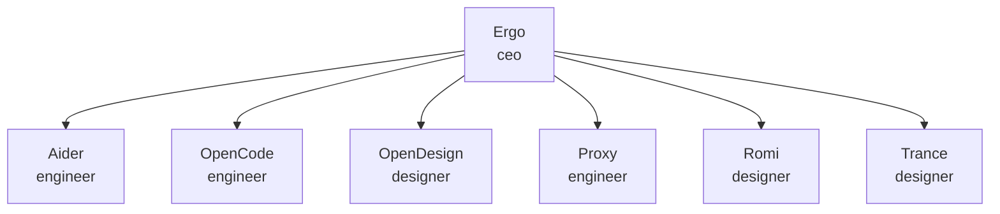

# Absolution Studios (ABS)

<!-- Generated by scripts/paperclip_export.py — edit company.json, not this file. -->

| Agent | Role | Adapter | Reports to | Title |
|---|---|---|---|---|
| Ergo | ceo | hermes_local | — | CEO / High-Orchestration Strategist |
| Aider | engineer | process | Ergo | Aider coding worker (process adapter) |
| OpenCode | engineer | opencode_local | Ergo | Code Execution Specialist / OpenCode Runner |
| OpenDesign | designer | opencode_local | Ergo | Design Execution Specialist / Prototype Builder |
| Proxy | engineer | hermes_local | Ergo | Execution Specialist / Deep Builder |
| Romi | designer | hermes_local | Ergo | Creative Director / Design Strategist |
| Trance | designer | hermes_local | Ergo | Creative Director / Design Strategist |

**Projects:** Slighe
