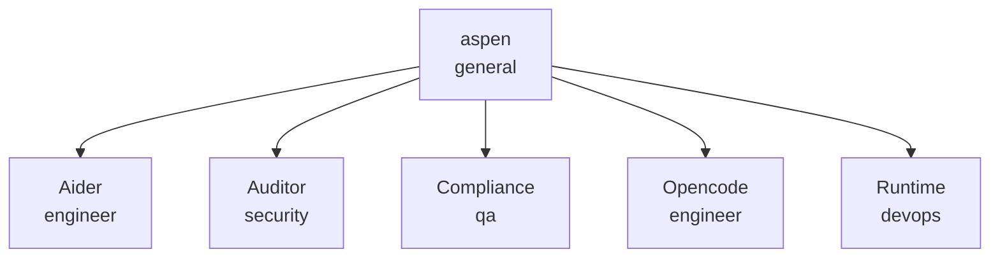

# Aspen OS Development Company (ASP)

<!-- Generated by scripts/paperclip_export.py — edit company.json, not this file. -->

Design, implement, harden, and continuously improve Aspen OS — an AI-first, local-first command-and-control operating system for autonomous manufacturing and dark factories. We operate as an interconnected grove of specialized intelligence.

| Agent | Role | Adapter | Reports to | Title |
|---|---|---|---|---|
| aspen | general | hermes_local | — | Aspen Architect — principal systems designer for Aspen OS |
| Aider | engineer | process | aspen | Aider coding worker (process adapter) |
| Auditor | security | hermes_local | aspen | Fleet & Security Auditor for Aspen OS |
| Compliance | qa | hermes_local | aspen | Manufacturing Compliance Agent for Aspen OS |
| Opencode | engineer | opencode_local | aspen | Aspen Implementation Engineer — senior coding agent for Aspen OS Development Company |
| Runtime | devops | hermes_local | aspen | Core Runtime Agent for Aspen OS |

**Projects:** AspenOS, Captain's Log, Grok Build Sim-Prod
