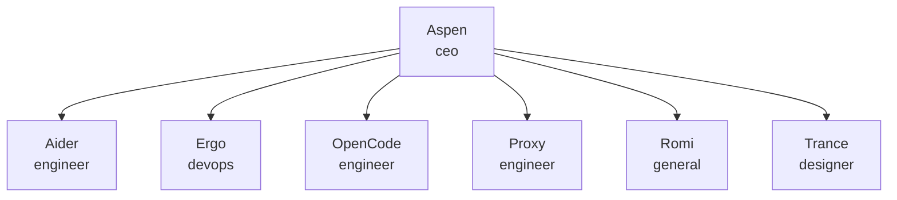

# BellahTech (BTH)

<!-- Generated by scripts/paperclip_export.py — edit company.json, not this file. -->

Holding company and local-first company OS for BellahTech ventures. Existing operating companies (Aspen OS Development, Absolution Digital Commerce, Bellah Content Studio, Absolution Studios) remain live and map to projects under this holding. Current Paperclip agents stay. Conversation faces: Aspen, Ergo, Proxy, Trance, Romi. Linear team BEL is the work SoR.

| Agent | Role | Adapter | Reports to | Title |
|---|---|---|---|---|
| Aspen | ceo | hermes_local | — | CEO / Build & Ventures |
| Aider | engineer | process | Aspen | Aider coding worker |
| Ergo | devops | hermes_local | Aspen | Systems / Orchestration |
| OpenCode | engineer | opencode_local | Aspen | Implementation engineer |
| Proxy | engineer | hermes_local | Aspen | Security + Implementation |
| Romi | general | hermes_local | Aspen | Personal assistant + Chief of Staff |
| Trance | designer | hermes_local | Aspen | Diplomacy + Creative |

**Projects:** Absolution Digital Commerce, Absolution Studios, Bellah Content Studio
